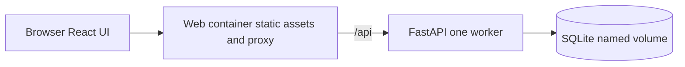

# Architecture and API contract

## Decision

Use a modular monolith with one API, one SQLite file and one frontend. SQLite is persistent storage inside the API service, not an unnecessary database server. The default Compose application needs two services.



The web container serves the Vite build and proxies /api to FastAPI under the same origin. No production CORS exception is needed. Backend modules separate routes, validation, scoring/finalization services and repositories. Python's sqlite3 is sufficient; keep SQL explicit and parameterized. Use numbered SQL migrations and a schema_version table; no ORM or migration framework is needed for this schema.

## Planned repository structure

```text
frontend/src/{components,pages,api}
frontend/tests
backend/app/{routes,services,repositories}
backend/tests/{unit,integration}
backend/migrations
tests/e2e
docs/evidence
.github/workflows
compose.yaml
```

These directories and runtime files are future deliverables.

## Data model

| Table | Main columns and constraints |
| --- | --- |
| tasks | id PK, title, description, state, created_at UTC, updated_at UTC |
| criteria | id PK, task_id FK, title, description, max_points CHECK 1..10, position; unique task_id + position |
| evaluations | id PK, task_id FK, model_label, model_version, state, parent_evaluation_id nullable FK, issue_description, fix_summary, created_at, finalized_at |
| results | evaluation_id FK + criterion_id FK composite PK, verification, points nullable, evidence_ref, notes |
| schema_version | version PK, applied_at UTC |

Results are inserted for all task criteria in the same transaction as evaluation creation. Service validation checks criterion/task consistency and same-task parents; foreign keys alone are insufficient. Enable foreign_keys on every connection; set a bounded busy timeout and use short write transactions. One worker and low demo traffic are explicit limits. Totals derive from rows and are not stored separately.

Database constraints reject negative points and contradictory null states; the service enforces each criterion's upper bound. Finalization rereads every result inside a transaction before changing state. Writes to finalized evaluations, locked criteria or archived tasks return 409. A failed mutation must leave all tables unchanged.

## API contract

All routes use /api. IDs are opaque server-generated identifiers.

| Method and route | Purpose | Successful response |
| --- | --- | --- |
| GET /health | Process readiness plus database read check | 200 |
| GET /tasks?state=ACTIVE | List/filter tasks | 200 |
| POST /tasks | Create draft task | 201 + task |
| GET /tasks/{id} | Read task and criteria | 200 |
| PATCH /tasks/{id} | Edit title/description/state under lifecycle rules | 200 |
| POST /tasks/{id}/criteria | Add a criterion | 201 |
| PATCH /criteria/{id} | Edit an unlocked criterion | 200 |
| DELETE /criteria/{id} | Remove an unlocked criterion | 204 |
| GET /tasks/{id}/evaluations | List evaluations ordered by creation time | 200 |
| POST /tasks/{id}/evaluations | Create draft; optional parent and required Debug fields | 201 |
| GET /evaluations/{id} | Results, coverage, total and parent comparison | 200 |
| PUT /evaluations/{id}/results/{criterion_id} | Save one draft observation | 200 |
| POST /evaluations/{id}/finalize | Validate all observations and lock | 200 |

Malformed/invalid fields return 422; unknown resources 404; lifecycle conflicts 409; public read-only mutations 403. Errors use a documented JSON code/message with field details where applicable; do not leak SQL or stack traces. OpenAPI is generated from implemented schemas and checked against this contract during implementation.

## Task lifecycle HTTP outcomes

These rules apply to existing resources with otherwise valid payloads in local write-enabled mode. Invalid fields return 422; unknown resources return 404. Every rejected mutation leaves database rows, counts, ordering and timestamps unchanged, including any other fields supplied in the same request.

| Operation and precondition | HTTP result | Stored outcome |
| --- | --- | --- |
| DRAFT -> ACTIVE with 1-20 valid criteria | 200 | State becomes ACTIVE |
| DRAFT -> ACTIVE with no criteria | 409 | No changes |
| ACTIVE -> DRAFT | 409 | No changes |
| DRAFT or ACTIVE -> ARCHIVED | 200 | State becomes ARCHIVED; history retained |
| Any mutation of ARCHIVED, including metadata edits or reactivation | 409 | No changes; reads remain available |
| Edit title/description of DRAFT or ACTIVE | 200 | Valid metadata saved; state unchanged |
| Add a valid criterion to an unlocked DRAFT or ACTIVE task with fewer than 20 criteria | 201 | One criterion added |
| Add a 21st criterion to an otherwise unlocked task | 422, code CRITERION_LIMIT_EXCEEDED | No changes; input error identifies the 20-criterion limit |
| Edit an unlocked criterion with valid fields | 200 | Criterion saved |
| Delete an unlocked criterion, except the last criterion of ACTIVE | 204 | Criterion removed |
| Delete the last criterion of ACTIVE | 409 | No changes |
| Create an Evaluation for DRAFT or ARCHIVED | 409 | No evaluation or result rows created |
| Create the first Evaluation for ACTIVE | 201 | Evaluation and results created atomically; task criteria become locked |
| Add/edit/delete/reorder criteria after any Evaluation exists | 409 | No changes, including scores and history |

DRAFT permits zero criteria; no task may exceed 20. ACTIVE must retain at least one valid criterion. ARCHIVED has no outgoing transition. Criterion locking does not prevent editing the title/description of an ACTIVE task. An Evaluation in DRAFT state still locks the task criteria; finalization is not required for the lock.

The Evaluation-creation guard and criterion lock after real Evaluation creation are scheduled for implementation and testing in P03. P02 implements task/criterion behavior before any Evaluation exists; it must not fabricate passing evidence for the later guard.

## Persistence and synthetic data

Use /data/tracker.db on a named Compose volume. Startup applies missing migrations and seeds only an empty database using fixed synthetic IDs in one transaction. Restarting must never duplicate or overwrite user-created mock records. Tests use temporary database files, not the demo volume. No automatic reset on application startup.

## Public demo

Set DEMO_READ_ONLY=true on hosted environments and show a visible banner. Enforce it in the API, including direct mutation calls; hiding UI buttons is insufficient. Local mode allows writes. Evidence references are inert text, not fetched or rendered as HTML. Credentials, headers and user notes are excluded from logs.
